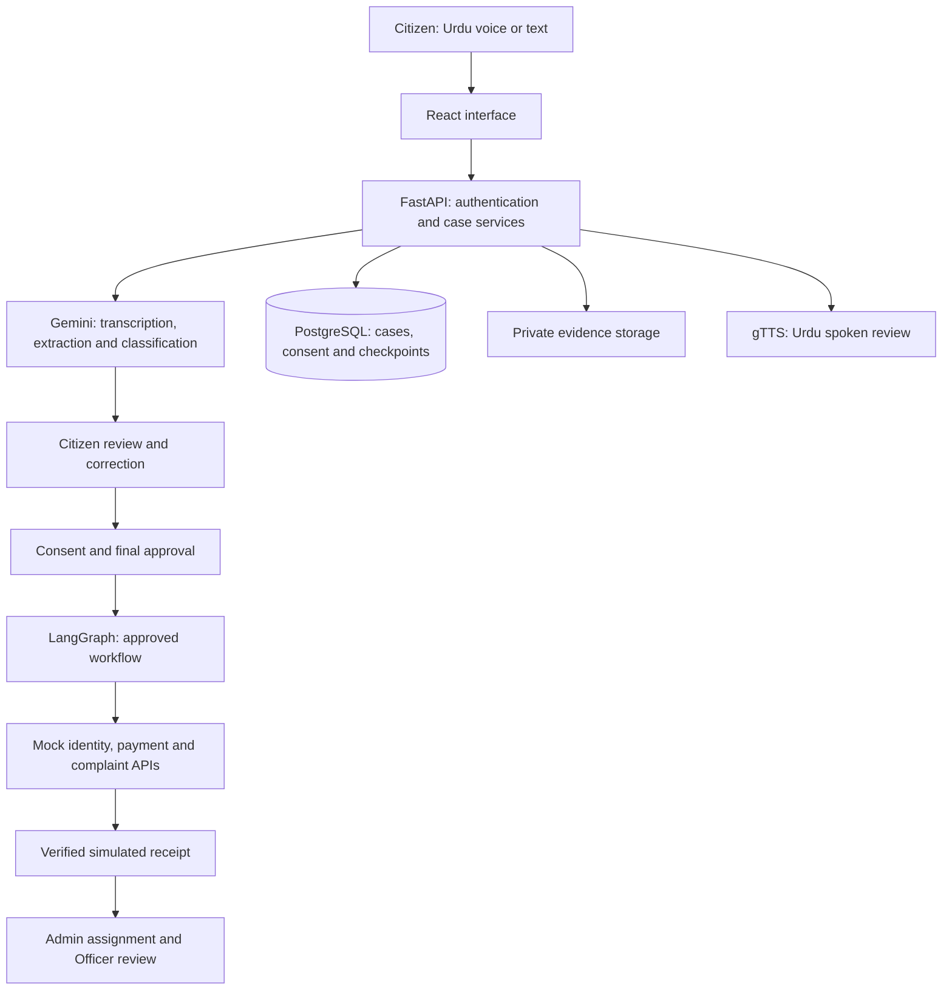

<div align="center">

# DASTAK · دستک

### Explain the problem. Review the form. Take action.

An Urdu-first AI assistant that turns spoken fraud reports into structured, citizen-approved complaints with trackable progress.

[](https://github.com/mugheeskhan5/we-in/actions/workflows/backend.yml)
[](https://github.com/mugheeskhan5/we-in/actions/workflows/frontend.yml)


**[Open Live Demo](https://dastak-web.onrender.com/login)** ·
**[Deployment Guide](DEPLOYMENT.md)** ·
**[Demo & Evaluation](DEMO_AND_EVALUATION.md)** ·
**[API Contract](contracts/openapi.yaml)**

</div>

> [!IMPORTANT]
> **Hackathon prototype — simulated public services.**
> Dastak is not an official government portal. Identity checks, payment lookups,
> reporting destinations and submission receipts are simulated and labelled.
> Use synthetic information only.

## Why Dastak?

Digital infrastructure is useful only when people can use it confidently.

A citizen may be able to describe what happened but still struggle to understand
a form, decide which details matter or determine where to report a suspected scam.

Dastak starts with that explanation. It helps the citizen organize the facts,
review a prepared complaint in Urdu, approve what is shared and follow the case
through human review.

**Our focus:** helping Urdu-speaking citizens report suspected online financial fraud.

| The barrier | How Dastak helps |
|---|---|
| “I can explain it, but I cannot fill this form.” | Urdu voice input becomes structured suggestions for the complaint form. |
| “I do not remember every detail.” | Unknown facts stay unknown; follow-up questions identify missing information. |
| “I want to check what you understood.” | Editable facts, a prepared complaint and Urdu spoken review. |
| “Who will receive my information?” | Named recipients, scoped consent and separate final submission approval. |
| “What happens after I submit?” | Saved workflow progress, a simulated reference and case-status tracking. |

## From a voice note to an actionable case

**Speak → Confirm facts → Review the form → Approve sharing → Submit → Track**

For example, a citizen says:

> مجھے واٹس ایپ پر امداد کا ایک جعلی پیغام ملا۔ میں نے پندرہ سو پاکستانی روپے بھیج دیے۔ مجھے واقعے کی درست تاریخ یاد نہیں۔

Dastak proposes structured fields for the citizen to confirm:

| Field | Proposed value |
|---|---|
| Incident type | Fake aid scam |
| Platform | WhatsApp |
| Amount | 1,500 |
| Currency | PKR |
| Incident date | Unknown — not invented |

The citizen can correct these suggestions before applying them.
A voice recording never authorizes filing by itself.

## What actually works

| Capability | What you can demonstrate |
|---|---|
| **Urdu voice assistance** | Record an explanation, review the transcript and listen to an Urdu summary. |
| **AI-assisted form filling** | Extract facts into defined fields and explicitly apply confirmed suggestions. |
| **Classification and follow-up** | Identify the reported incident category and surface missing or contradictory details. |
| **Prepared complaint** | Review, correct and download the generated complaint before approval. |
| **Approved tool workflow** | Run identity, payment, reporting and receipt steps against mock services. |
| **Human assistance** | Request Helper guidance, receive a response and decide what to correct. |
| **Officer processing** | Assign a case, request clarification, receive a response and record an outcome. |
| **Consent controls** | Grant required sharing together and withdraw recipient access. |
| **Private evidence** | Upload validated files and verify downloaded evidence using SHA-256. |
| **Persistent progress** | Recover saved cases, workflow checkpoints and interrupted local drafts. |
| **Audit and explainability** | Inspect routing reasons, rule versions, consent events and workflow actions. |
| **Scoped API access** | Issue expiring, revocable API keys for authorized backend integrations. |

## Try the live demo

**Application:** https://dastak-web.onrender.com/login

A dedicated beta account can be provided upon request.

<details>
<summary><strong>Show demo accounts</strong></summary>

| Role | Username | Access |
|---|---|---|
| Citizen | `demo-citizen-1` | Own complaints |
| Citizen | `demo-citizen-2` | Separate citizen account |
| Community Helper | `demo-helper` | Citizen-authorized assistance |
| Financial Officer | `demo-officer-financial` | Assigned financial workspace cases |
| Digital Safety Officer | `demo-officer-digital` | Assigned digital-safety workspace cases |
| Admin | `demo-admin` | Governance, assignment and audit |

**Shared password for the hosted demo:** `DemoPass1234!`

These credentials are for the synthetic demonstration environment.
Local installations use the password configured in `DASTAK_DEMO_PASSWORD`.

</details>

### A three-minute walkthrough

1. Sign in as a Citizen and record a short synthetic Urdu complaint.
2. Show the extracted facts and confirm selected form fields.
3. Make a correction, review the prepared complaint and play its Urdu summary.
4. Review recipients, grant sharing and explicitly authorize submission.
5. Watch the saved workflow steps and open the verified simulated receipt.
6. Return to the case to show its saved status.

For the extended demonstration, switch to Admin for Officer assignment,
then show clarification and resolution from the Officer and Citizen screens.

> Free hosting can introduce a delay while the backend wakes up.
> Provider-dependent AI features also require available Gemini quota.

## Architecture



**AI interprets the report. Backend rules enforce authority. The citizen controls submission.**

Gemini does not independently grant consent, choose unrestricted tools or
determine a case outcome. LangGraph coordinates a defined, approved workflow;
routing and access boundaries are enforced by backend services.

## Human review is part of the workflow

| Role | Responsibility |
|---|---|
| **Citizen** | Confirms facts, corrects the complaint, controls sharing and authorizes submission. |
| **Community Helper** | Provides guidance after an explicit assistance request and access grant. |
| **Admin** | Manages users, routing, API keys and matching Officer assignments. |
| **Department Officer** | Reviews assigned cases, requests clarification and records outcomes. |

A Helper's note does not change the citizen's statement or authorize filing.
Admin privileges do not automatically expose private evidence or bypass consent.

### When does the system stop?

Readiness uses four weighted signals:

| Signal | Weight |
|---|---:|
| Classification confidence | 35% |
| Required-field completeness | 30% |
| Consistency | 20% |
| Matching routing rule | 15% |

- **Human review:** unresolved contradictions, a possible duplicate, an unsupported
  or unclear category, no matching route, or a readiness score below **0.60**.
- **More information:** otherwise, missing required information or a score below **0.85**.
- **Citizen review:** a score of at least **0.85**, complete required information
  and no blocking conditions.

These are prototype policy thresholds, not calibrated probabilities of correctness.
Even a high score does not bypass citizen approval.
Helper assignment is requested explicitly rather than triggered silently.

## Designed for controlled integrations

Administrators can issue API keys with selected scopes, an expiry and immediate revocation.

External applications call documented endpoints using the `X-API-Key` header.
Scopes restrict the operations a key may perform; associated user permissions,
case access and applicable consent checks still apply.

This provides a foundation for authorized partner integrations.
**Issuing a key does not establish a connection to NADRA, Raast or another public platform.**
Production integrations require authorization and agreed service contracts.

See [API Keys & Audit](backend/API_KEYS_AND_AUDIT.md).

## Engineering checks

The deployment-audit version passed:

| Verification | Result |
|---|---:|
| SQLite backend regression | **406 passed**, 13 PostgreSQL-only tests skipped |
| PostgreSQL backend regression | **419 passed** |
| Browser integration workflows | **23 passed** |
| Frontend deployment configuration | **11 passed** |
| Production frontend build | Passed |
| Backend lint and formatting | Passed |
| Docker migration, seed and startup | Passed |
| Non-root evidence storage and audio decoder | Passed |

Counts are a snapshot of the deployment audit, not a live coverage measurement.
The workflow badges above show the current `main` status.
Frontend lint completes with existing warnings.

The backend suites cover API behavior, migrations, contracts, role boundaries,
consent, evidence access, submission recovery and duplicate protection.
Browser tests exercise integrated user workflows with isolated synthetic fixtures.

### AI evaluation

The repository includes **36 labelled synthetic cases** across English, Urdu and Roman Urdu.

Cases cover unknown facts, payment references, contradictions, impersonation,
phishing, out-of-scope requests and hostile instructions embedded in scam text.

The evaluation reports critical-field agreement, unknown preservation,
classification, handling, timing and provider failures separately.
It is available as a CLI and JSON report.

See [Demo & Evaluation](DEMO_AND_EVALUATION.md) for commands and methodology.

## Technology

| Layer | Stack | Purpose |
|---|---|---|
| Frontend | React, TypeScript, Vite, Tailwind CSS | Bilingual, role-based user interface |
| Backend | FastAPI, Pydantic | Documented APIs and structured validation |
| AI interpretation | Gemini | Urdu transcription, extraction and classification |
| Spoken review | gTTS | Urdu text-to-speech |
| Workflow | LangGraph | Approved steps and saved execution progress |
| Persistence | PostgreSQL, SQLAlchemy, Alembic | Cases, permissions and schema migrations |
| Hosted storage | Supabase private Storage | Persistent private evidence |
| Deployment | Render, Docker | Static frontend and backend service |
| Verification | pytest, Playwright, Ruff, GitHub Actions | Regression, browser and deployment checks |

## Run locally

### Prerequisites

- Docker Desktop with Docker Compose
- Node.js 24 and npm
- A Gemini key and an available model for AI features
- Python 3.12 for backend development outside Docker

### 1. Configure the backend

From the repository root:

```powershell
if (-not (Test-Path .env)) { Copy-Item .env.example .env }
python -c "import secrets; print(secrets.token_urlsafe(48))"
```

Set these values in `.env`:

- A unique JWT secret using the generated value
- A URL-safe PostgreSQL password
- `DASTAK_DEMO_PASSWORD` with at least 12 characters
- Your Gemini API key and available model

Keep credentials out of commits. Preserve existing environment values when updating.

### 2. Start and seed

```powershell
docker compose up --build -d
docker compose run --rm api python -m app.seed
docker compose exec api python -m app.release_check
```

Compose starts PostgreSQL and applies migrations before the API starts.
Seeding preserves existing accounts and passwords.

### 3. Start the frontend

In a second terminal:

```powershell
Set-Location "hackathon frontend"
if (-not (Test-Path .env)) { Copy-Item .env.example .env }
npm ci
npm run dev -- --host 127.0.0.1 --port 5173 --strictPort
```

| Service | Local URL |
|---|---|
| Application | http://127.0.0.1:5173/login |
| API documentation | http://localhost:8000/docs |
| Readiness | http://localhost:8000/api/v1/health/ready |

Local accounts use your configured `DASTAK_DEMO_PASSWORD`.
Rerunning the seed does not reset an existing password.

## Deploy

The repository includes a Render Blueprint in [`render.yaml`](render.yaml).

The hosted configuration uses:

- A static frontend and Docker API on Render
- Supabase PostgreSQL
- A private Supabase evidence bucket
- Server-side Gemini and storage credentials
- Exact HTTPS origins for frontend access

Follow **[DEPLOYMENT.md](DEPLOYMENT.md)** for setup, environment variables,
acceptance checks, backups and rollback.

The primary repository is [mugheeskhan5/we-in](https://github.com/mugheeskhan5/we-in).
The deployment fork is [Abdullahs18/we-in](https://github.com/Abdullahs18/we-in).

## Verification commands

<details>
<summary><strong>Backend checks</strong></summary>

From an activated Python 3.12 environment in `backend`:

```powershell
python -m pip install -r requirements-dev.txt
python -m pytest -q
ruff check app migrations tests
ruff format --check app migrations tests
```

For PostgreSQL verification, configure `TEST_DATABASE_URL` against a dedicated,
disposable test database. Tests apply and downgrade migrations.

**Never point the test suite at an application database containing wanted data.**

</details>

<details>
<summary><strong>Frontend and browser checks</strong></summary>

From `hackathon frontend`:

```powershell
node --test deployment-tests/config.test.mjs
npm run build
npm run lint
npx playwright install chromium --only-shell
npm run test:e2e
```

The browser suite starts isolated API and storage fixtures.
It also requires the backend development dependencies and a Python interpreter
available to the test runner.

</details>

## Prototype boundaries

| Available today | Outside this prototype |
|---|---|
| Assisted filling of Dastak complaint forms | Arbitrary external government-form automation |
| Mock identity, payment and reporting APIs | Authorized live government integrations |
| Structured extraction and classification | Official-source RAG |
| Private evidence upload and integrity checks | OCR, QR verification and forgery detection |
| Local draft recovery and reconnect syncing | Full offline-first synchronization |
| Duplicate-review and contradiction checks | Trained payment-anomaly detection |
| CLI/JSON evaluation reports | Dedicated evaluation dashboard |

All implemented features work in our tested scenarios.
AI output still requires review, and provider-dependent features require network
access and available quota.

## Documentation

| Guide | Contents |
|---|---|
| [Deployment](DEPLOYMENT.md) | Hosting, credentials, persistence, backups and rollback |
| [Demo & Evaluation](DEMO_AND_EVALUATION.md) | Full-role demo and AI evaluation |
| [Integration](INTEGRATION.md) | Frontend/backend integration |
| [Integrated Voice](backend/INTEGRATED_VOICE.md) | Complaint voice workflow |
| [Evidence](backend/EVIDENCE.md) | Uploads, integrity and access |
| [Submission](backend/SUBMISSION.md) | Approval, workflow and recovery |
| [Officer Review](backend/OFFICER_REVIEW.md) | Clarification and case outcomes |
| [API Keys & Audit](backend/API_KEYS_AND_AUDIT.md) | Scoped integration access and traces |
| [API Contract](contracts/openapi.yaml) | Canonical endpoint definitions |
| [Project Plan](plan.md) | Original scope and implementation plan |

---

<div align="center">

**DASTAK · دستک**

Helping people move from explaining a problem to taking an informed next step.

</div>
